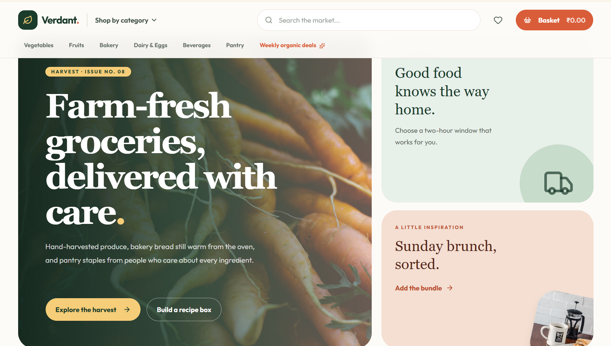
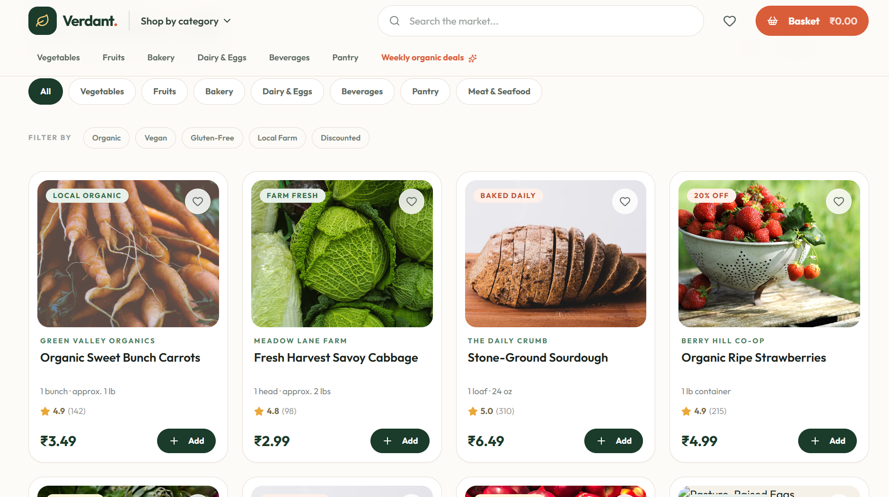
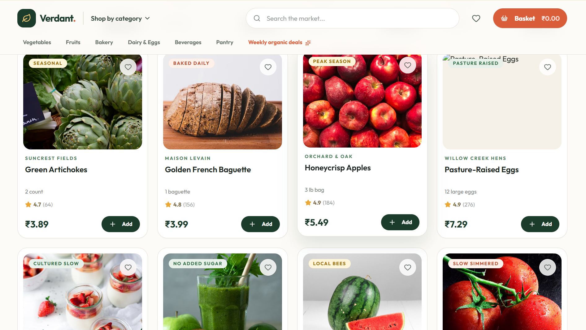

# Decentralized Grab-and-Go Retail

An academic prototype for cashierless shopping in small and independent retail stores. The project explores a low-cost, privacy-conscious alternative to large cloud-based autonomous checkout systems.

## Project overview

The proposed system uses cameras and an edge device (such as a Raspberry Pi or NVIDIA Jetson) to detect hands and products locally. A YOLO-based vision model supplies object locations to an IoU spatial interaction engine, which classifies customer interactions as **Touch**, **Take**, or **Return**. A **Dynamic Resting State** algorithm is intended to update the shelf map when products are moved and remain in a new position. Validated Take and Return events are then sent over a local WebSocket connection to update a customer's virtual basket.

The intended flow is:

```text
Shelf camera → Edge vision model → IoU interaction logic → Shelf-state update
                                      ↓
                         Local WebSocket → Shopping basket
```

Processing video on the edge is intended to reduce cloud dependence and keep raw camera footage local. The project documents describe this as a prototype under development; the website in this repository is its customer-facing frontend mockup.

## What is built in this repository

The current frontend is a responsive, static grocery storefront branded **Verdant**. It is built with plain HTML, CSS, and JavaScript, with no build step or package installation.

- Editorial homepage with a produce photo hero, delivery panel, and bakery promotion.
- Grocery catalogue with real food photography, product details, ratings, units, and example prices in Indian rupees.
- Search, category selection, dietary/source filters, and price/rating sorting.
- Favourite toggles and a basket drawer with add, remove, quantity, and subtotal controls.
- Responsive layouts for desktop and mobile screens.

### Current boundary

The shop is currently a frontend demonstration. Basket changes stay in browser memory; checkout displays a coming-soon message. Product prices and ratings are sample catalogue data. This repository does **not** currently connect to a YOLO model, camera feed, IoU event service, Dynamic Resting State implementation, WebSocket server, payment provider, or edge hardware. Those components are part of the wider project architecture and need integration to make the basket respond to detected shelf interactions.

## Run the frontend

Open `index.html` directly in a modern browser, or serve this folder locally:

```bash
python -m http.server 8000
```

Then open <http://localhost:8000>. The product photography and web fonts are loaded from the internet, so those assets require a network connection.

## Screenshots

These are the **website design reference screenshots supplied with the project brief**. They document the visual direction used for the current Verdant storefront; they are not screenshots of the running implementation.

### Homepage reference



### Product catalogue reference





## Project files

| File | Purpose |
| --- | --- |
| `index.html` | Storefront page structure |
| `styles.css` | Visual styling and responsive layouts |
| `app.js` | Product data and frontend interactions |
| `screenshots/` | Reference screenshots supplied for the storefront design |

## Notes

- Prices are examples in INR and can vary with location, season, and retailer. They are not live inventory prices.
- Product photos are served by Unsplash URLs and need an internet connection.
- The project proposal and invention disclosure describe the broader edge-based retail system; this README separates that planned system from the frontend functionality currently present in this folder.
